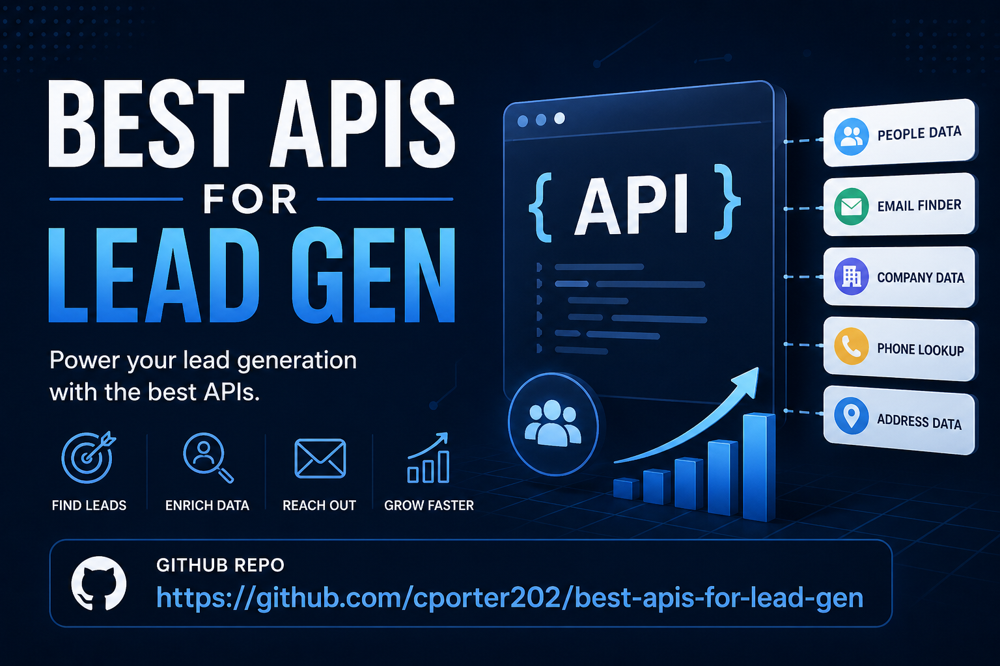

<div align="center">

# Best APIs for Lead Gen




**A curated API directory for building lead generation products, automations, agency services, and outbound research workflows.**

[](apis/)
[](workflows/)
[](playbooks/)
[](categories/)
[](#what-counts-as-lead-gen-here)

<br>

<a href="https://github.com/cporter202/best-apis-for-lead-gen/stargazers">
  
</a>
<a href="https://github.com/cporter202/best-apis-for-lead-gen/network/members">
  
</a>

<br><br>

<a href="apis/"><strong>Browse APIs</strong></a>
&nbsp;|&nbsp;
<a href="workflows/"><strong>Explore Workflows</strong></a>
&nbsp;|&nbsp;
<a href="playbooks/"><strong>Browse Playbooks</strong></a>
&nbsp;|&nbsp;
<a href="categories/"><strong>Use Case Index</strong></a>

</div>

---

<!-- APIMESA-FEATURED-START -->
## ⭐ Featured: APIMesa

<p align="center">
  <a href="https://apimesa.com" target="_blank" rel="noopener">
    
  </a>
</p>

**[APIMesa](https://apimesa.com)** is a pay-per-call API marketplace with 150+ live APIs for AI, scraping, data, SEO, lead generation, media, and developer utilities — one API key, clear per-call credit pricing, and a live playground for every API.

<!-- APIMESA-FEATURED-END -->

## The Short Version

This repo is a practical shortlist for builders who want to find prospects, enrich records, validate contact data, monitor buying signals, and turn public business data into useful lead generation systems.

It is intentionally not a giant generic API dump. Every API here should help you build something closer to revenue: a lead list, enrichment workflow, prospecting dashboard, agency offer, outbound research assistant, or niche SaaS product.

## GitHub About Tags

Use these as GitHub repository topics:

`lead-generation` `apis` `prospecting` `sales-automation` `b2b-sales` `data-enrichment` `email-finder` `web-scraping` `outbound-sales` `local-business` `ecommerce-leads` `job-signals` `intent-data` `crm-enrichment`

## Why This Repo Exists

Most API directories optimize for size. Lead generation builders need something different: APIs grouped by business use case, practical workflow fit, data quality risk, and monetization potential.

<table>
  <tr>
    <td width="33%">
      <strong>Find leads</strong><br>
      Maps, directories, marketplaces, startups, jobs, properties, and public profiles.
    </td>
    <td width="33%">
      <strong>Enrich records</strong><br>
      Emails, phones, social links, company data, technology stacks, and qualification fields.
    </td>
    <td width="33%">
      <strong>Spot timing</strong><br>
      Hiring, funding, reviews, social intent, marketplace activity, and service demand.
    </td>
  </tr>
</table>

## Who This Is For

| Builder | What You Can Use This For |
| --- | --- |
| Founders | Build lead gen SaaS, enrichment tools, data products, or prospecting dashboards |
| Agencies | Create repeatable local, ecommerce, startup, contractor, and B2B lead services |
| Sales operators | Design outbound workflows with cleaner inputs and better trigger signals |
| Automation specialists | Connect scrapers, enrichment APIs, validators, CRMs, and outreach tools |
| Builders | Find practical API-backed software ideas with monetization paths |

## What Counts As Lead Gen Here

An API belongs in this repo only if it helps with one or more of these jobs:

| Job | Examples |
| --- | --- |
| Discover prospects | Businesses, sellers, creators, properties, jobs, startups, or companies worth contacting |
| Extract useful data | Company pages, websites, directories, marketplaces, public profiles, reviews, or job posts |
| Enrich records | Emails, phones, social links, decision makers, company data, funding, or technology usage |
| Validate contacts | Email hygiene, duplicate removal, source confidence, or outreach readiness |
| Monitor signals | Hiring, funding, reviews, technology changes, public demand, or social intent |
| Support workflows | Prospect research, qualification, routing, CRM enrichment, or outbound prep |

## Quick Navigation

| Section | What You Get |
| --- | --- |
| [apis/](apis/) | Curated API profiles with use cases, strengths, weaknesses, pricing notes, and workflow fit |
| [workflows/](workflows/) | Practical ways to combine APIs into lead generation systems |
| [playbooks/](playbooks/) | SaaS, agency, data product, and service ideas you can build around the APIs |
| [categories/](categories/) | API indexes by use case, including local, ecommerce, job signals, enrichment, and intent |
| [templates/](templates/) | Reusable templates for adding new APIs, workflows, playbooks, and categories |
| [resources/](resources/) | Curation criteria, enrichment strategy, scoring model, and compliance notes |

## Builder Paths

<table>
  <tr>
    <td width="33%">
      <strong>Local agency engine</strong><br>
      Scrape maps and directories, enrich contacts, validate emails, and sell niche local lead packs.
      <br><br>
      <a href="workflows/local-business-lead-machine.md">Open workflow</a>
    </td>
    <td width="33%">
      <strong>B2B signal engine</strong><br>
      Monitor hiring, funding, reviews, and public intent to prioritize accounts with a timely reason to buy.
      <br><br>
      <a href="workflows/hiring-signal-outbound-workflow.md">Open workflow</a>
    </td>
    <td width="33%">
      <strong>Enrichment engine</strong><br>
      Turn company domains into validated contacts, company context, fit scores, and CRM-ready records.
      <br><br>
      <a href="workflows/waterfall-enrichment-workflow.md">Open workflow</a>
    </td>
  </tr>
</table>

## Featured API Shortlist

| API | Best For | Category |
| --- | --- | --- |
| [Google Maps Scraper](apis/google-maps-scraper.md) | Local business discovery by niche and location | Local business lead gen |
| [Google Maps Email Extractor](apis/google-maps-email-extractor.md) | Turning map listings into outreach-ready local leads | Website/company scraping |
| [B2B Leads Finder](apis/b2b-leads-finder.md) | Apollo-style B2B lead exports with emails and phones | Lead discovery |
| [Smart Email Finder and Verifier](apis/smart-email-finder-verifier.md) | Finding and validating professional emails from name plus domain | Email finding |
| [AI Contact Details Scraper](apis/ai-contact-details-scraper.md) | Extracting emails, phones, and social links from company websites | Contact enrichment |
| [Clearbit Combined](apis/clearbit-combined.md) | Person and company enrichment through Tomba/Clearbit-style data | Company data |
| [Hunter.io](apis/hunter-io.md) | Email search and profile enrichment | Email finding |
| [BuiltWith Bulk URLs](apis/builtwith-bulk-urls.md) | Technology-based prospecting and segmentation | Company data |
| [Advanced LinkedIn Job Search API](apis/advanced-linkedin-job-search-api.md) | Hiring signal prospecting | Job signal lead gen |
| [Y Combinator Scraper](apis/y-combinator-scraper.md) | Startup prospecting by batch, industry, region, hiring, and founders | Company data |
| [Crunchbase Companies Scraper](apis/crunchbase-companies-scraper.md) | Funded company research and market mapping | Company data |
| [Amazon Seller Data Extractor](apis/amazon-seller-data-extractor.md) | Ecommerce seller research | Ecommerce lead gen |
| [Reddit Searcher](apis/reddit-searcher.md) | Pain-point and intent research from public discussions | Intent / trigger-based prospecting |
| [Tweet Scraper V2](apis/tweet-scraper-v2.md) | Social signal monitoring and creator/company research | Social/profile enrichment |
| [Zillow Contact API](apis/zillow-contact-api.md) | FSBO and real estate investor lead workflows | Real estate lead gen |

See the full curated list in [apis/](apis/).

## Featured Workflows

| Workflow | Goal | Best For |
| --- | --- | --- |
| [Local business lead machine](workflows/local-business-lead-machine.md) | Scrape local businesses, enrich contacts, validate, and qualify | Local agencies |
| [Ecommerce seller prospecting engine](workflows/ecommerce-seller-prospecting-engine.md) | Find marketplace sellers and prepare outreach lists | Ecommerce agencies |
| [Hiring signal outbound workflow](workflows/hiring-signal-outbound-workflow.md) | Use job postings as buying signals | Recruiters and B2B services |
| [Technology stack prospecting workflow](workflows/technology-stack-prospecting-workflow.md) | Segment prospects by website technologies | SaaS and migration offers |
| [Startup founder prospecting workflow](workflows/startup-founder-prospecting-workflow.md) | Build founder and startup account lists | Startup-focused sellers |
| [Review-triggered sales workflow](workflows/review-triggered-sales-workflow.md) | Turn public review pain into account research | Reputation and CX offers |
| [Real estate investor lead workflow](workflows/real-estate-investor-lead-workflow.md) | Find and qualify FSBO or property leads | Investors and agents |
| [Intent research to outreach workflow](workflows/intent-research-to-outreach-workflow.md) | Monitor public discussions for pain and demand | Social selling |
| [Directory mining workflow](workflows/directory-mining-workflow.md) | Convert niche directories into clean lists | Data services |
| [Waterfall enrichment workflow](workflows/waterfall-enrichment-workflow.md) | Improve lead completeness across multiple APIs | RevOps and enrichment tools |

## Featured Playbooks

| Playbook | Customer | Monetization Angle |
| --- | --- | --- |
| [Local lead scraper for agencies](playbooks/local-lead-scraper-for-agencies.md) | Local agencies | SaaS, lead packs, white-label exports |
| [Contractor lead intelligence dashboard](playbooks/contractor-lead-intelligence-dashboard.md) | Contractor-focused agencies | Monthly dashboard or market reports |
| [Ecommerce brand prospecting tool](playbooks/ecommerce-brand-prospecting-tool.md) | Ecommerce agencies and SaaS teams | Subscription or pay-per-export |
| [Recruiter lead sourcing assistant](playbooks/recruiter-lead-sourcing-assistant.md) | Recruiters and staffing firms | Hiring-trigger alerts |
| [Real estate investor lead finder](playbooks/real-estate-investor-lead-finder.md) | Investors and wholesalers | Market-based lead subscriptions |
| [B2B outbound research assistant](playbooks/b2b-outbound-research-assistant.md) | B2B sales teams | Usage-based enrichment |
| [Niche directory mining service](playbooks/niche-directory-mining-service.md) | Agencies and list buyers | Custom list building |
| [Signal-based outreach assistant](playbooks/signal-based-outreach-assistant.md) | SaaS and consulting teams | Signal monitoring subscription |
| [Startup account intelligence tool](playbooks/startup-account-intelligence-tool.md) | Startup-focused sellers | Account intelligence SaaS |
| [Review monitoring lead engine](playbooks/review-monitoring-lead-engine.md) | Reputation and CX teams | Competitor complaint reports |

## Browse By Use Case

- [Lead discovery](categories/lead-discovery.md)
- [Company data](categories/company-data.md)
- [Contact enrichment](categories/contact-enrichment.md)
- [Email finding](categories/email-finding.md)
- [Phone number enrichment](categories/phone-number-enrichment.md)
- [Social/profile enrichment](categories/social-profile-enrichment.md)
- [Website/company scraping](categories/website-company-scraping.md)
- [Local business lead gen](categories/local-business-lead-gen.md)
- [Ecommerce lead gen](categories/ecommerce-lead-gen.md)
- [Job signal lead gen](categories/job-signal-lead-gen.md)
- [Intent and trigger-based prospecting](categories/intent-trigger-prospecting.md)
- [Outreach automation support](categories/outreach-automation-support.md)

## Repository Structure

```text
README.md
apis/        Curated API profiles
workflows/   Practical multi-step lead generation workflows
playbooks/   Product, SaaS, and agency offer ideas
categories/  API indexes by lead generation use case
templates/   Reusable templates for adding APIs, workflows, and playbooks
resources/   Supporting strategy docs
```

## Star History

<div align="center">
  <a href="https://www.star-history.com/#cporter202/best-apis-for-lead-gen&Date">
    
  </a>
</div>

## Curation Notes

Many links in the source repo contained affiliate tracking, usually the Apify `fpr=p2hrc6` parameter. Those links were preserved where they already existed. Pricing notes are included only when they appeared clearly in the source material; otherwise profiles use "not specified in source."

Use these APIs responsibly. Follow each provider's terms, applicable platform rules, privacy law, and email/phone outreach requirements. This repo is about building useful prospecting systems, not spam.

## Add To This Repo

- Add a new API with [templates/api-profile-template.md](templates/api-profile-template.md)
- Add a workflow with [templates/workflow-template.md](templates/workflow-template.md)
- Add a playbook with [templates/playbook-template.md](templates/playbook-template.md)
- Use [templates/category-template.md](templates/category-template.md) for new category pages

The bar is intentionally high: fewer useful APIs beat a noisy list every time.

<!-- AIWITHCHRIS-BANNER-START -->
<p align="center">
  <a href="https://aiwithchris.com" target="_blank" rel="noopener">
    
  </a>
</p>
<p align="center">
  <a href="https://aiwithchris.com"><strong>🚀 Join my AI Playbook — aiwithchris.com</strong></a><br>
  $10/month · 3,600+ prompts · agent workflows · repo breakdowns · money ideas
</p>
<!-- AIWITHCHRIS-BANNER-END -->

